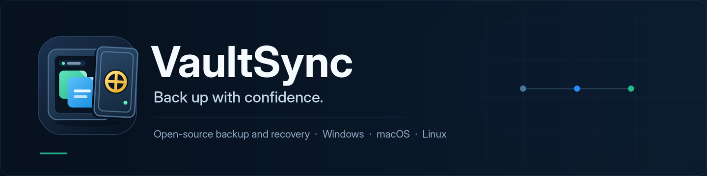
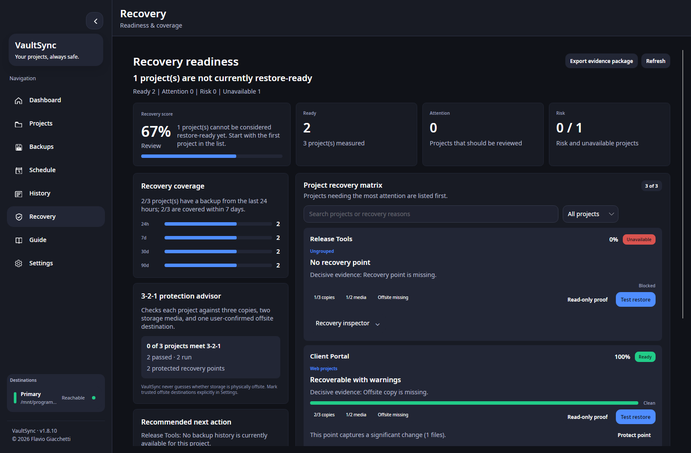
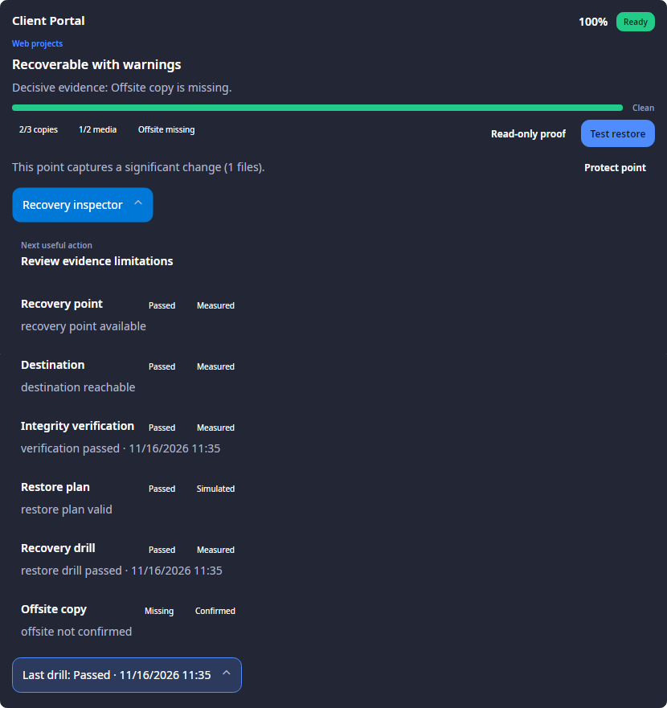
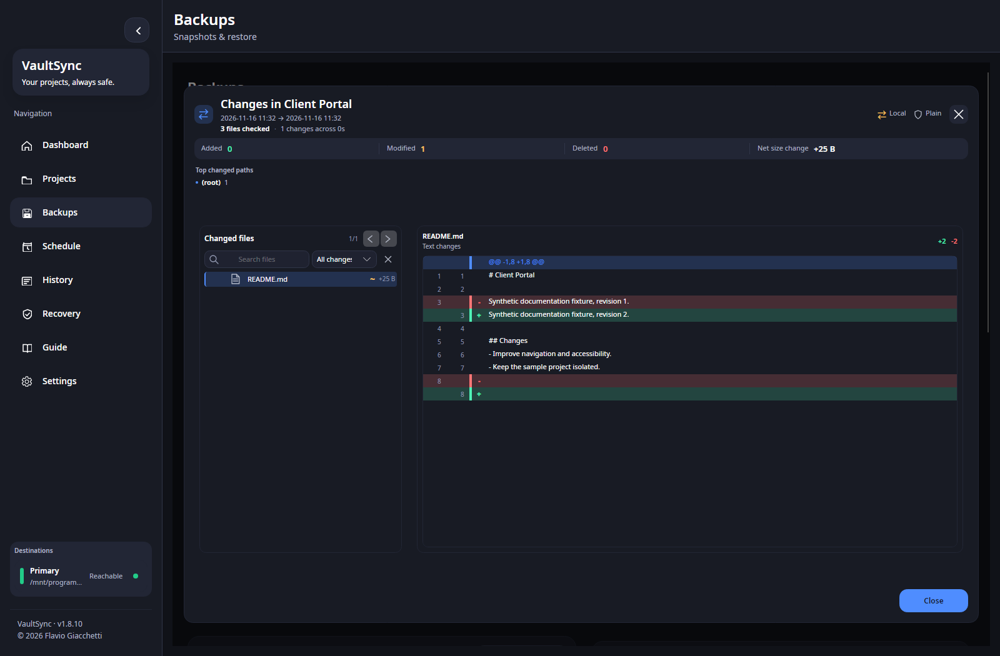
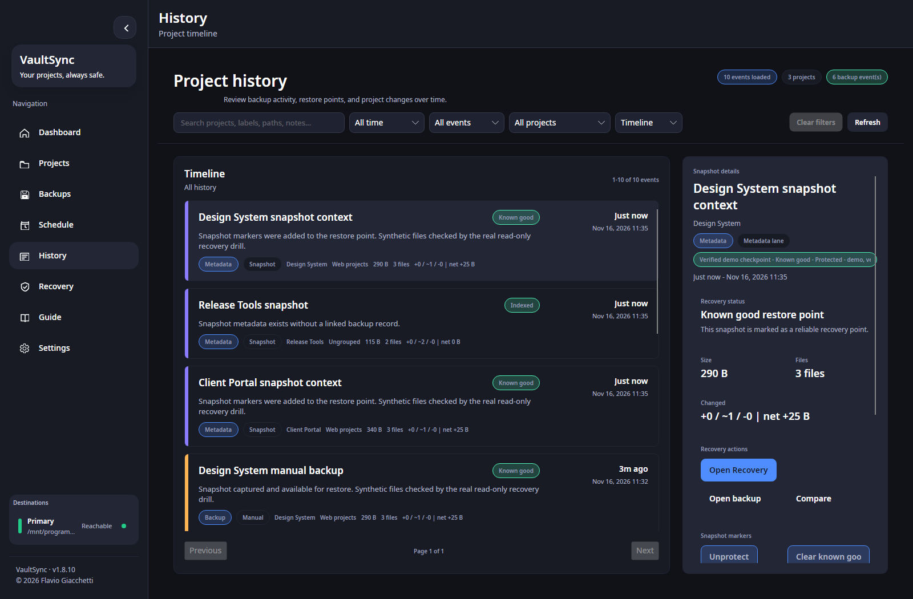
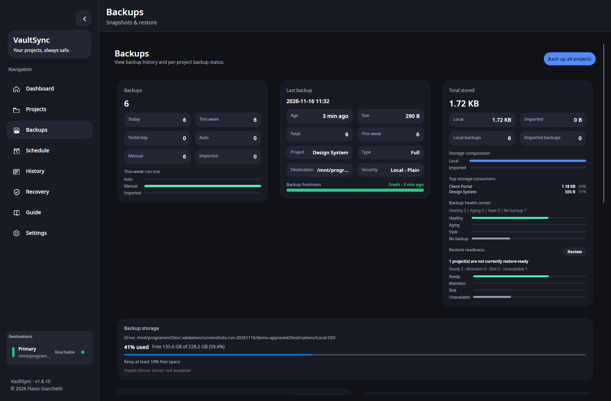
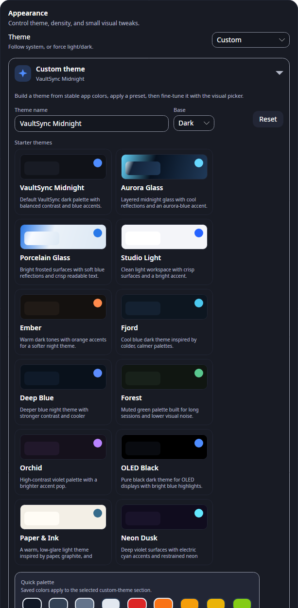
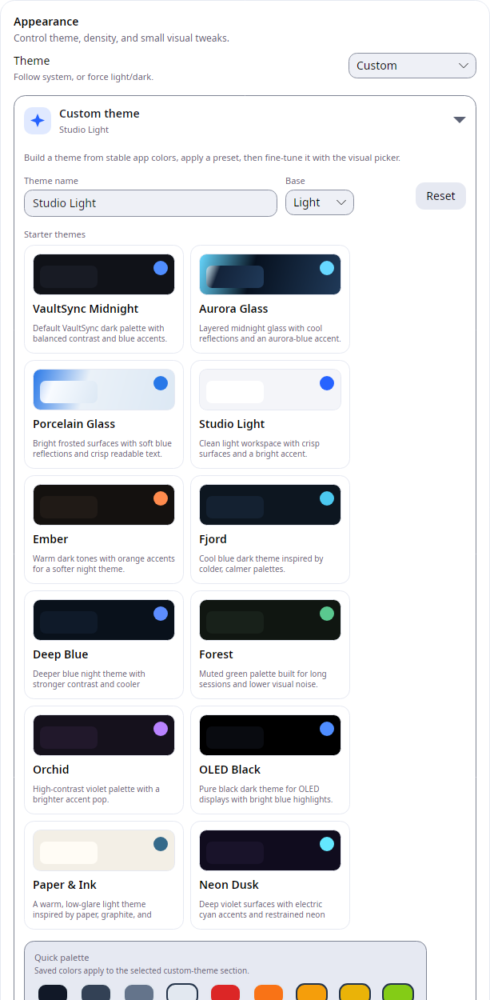
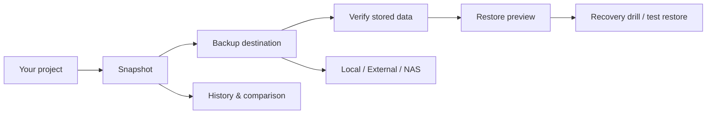
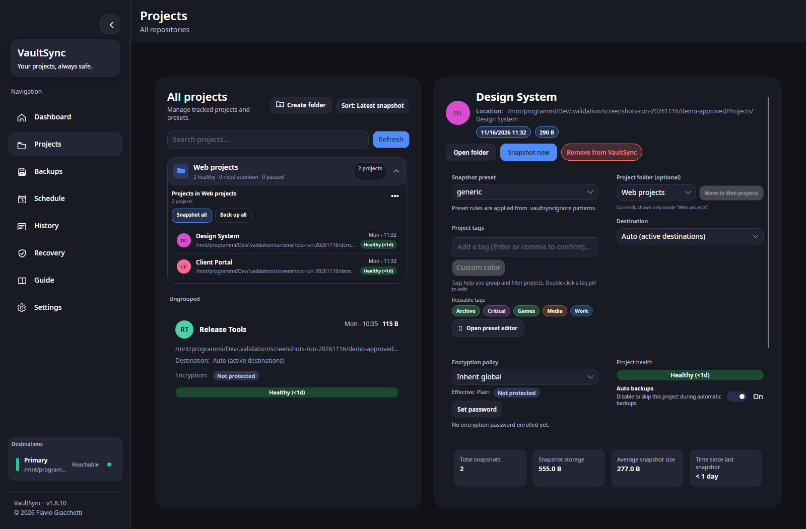

<p align="center">
  
</p>

<h1 align="center">VaultSync</h1>

<p align="center">
  <strong>Back up your projects. Verify your data. Recover with confidence.</strong>
</p>

<p align="center">
  Free, open-source desktop backup software for Windows, macOS, and Linux.
  Back up selected folders and development projects to local drives, external disks,
  or NAS storage. Schedule backups, verify stored files, and test restores
  without requiring a cloud account.
</p>

<p align="center">
  <a href="https://github.com/ATAC-Helicopter/VaultSync/releases/latest"><strong>Download</strong></a>
  &nbsp;·&nbsp;
  <a href="https://fglabs.dev/vaultsync">Website</a>
  &nbsp;·&nbsp;
  <a href="docs/wiki/Quick-Start.md">Quick Start</a>
  &nbsp;·&nbsp;
  <a href="DOCUMENTATION.md">Documentation</a>
  &nbsp;·&nbsp;
  <a href="https://discord.gg/sgP8UzeAQt">Community</a>
</p>

<p align="center">
  <a href="https://github.com/ATAC-Helicopter/VaultSync/releases/latest">
    
  </a>
  <a href="https://github.com/ATAC-Helicopter/VaultSync/releases">
    
  </a>
  <a href="LICENSE">
    
  </a>
</p>

<p align="center">
  
  
  
  
  <a href="https://github.com/ATAC-Helicopter/VaultSync/actions/workflows/ci.yml">
    
  </a>
</p>

---

## Beyond successful backups

**A backup finishing successfully is only the beginning.**

You should also know what changed, whether the stored data can still be read, and what a restore would actually do.

VaultSync brings those answers into one desktop application.

| Back up | Understand | Recover |
| :--- | :--- | :--- |
| Protect project folders using local storage, external drives, and NAS destinations. | Browse snapshots, inspect changes, and compare recovery points. | Verify stored bytes, preview restores, and run recovery drills. |
| Manual and scheduled protection | History and snapshot comparison | Evidence-backed recovery checks |

No mandatory cloud account. No automatic crash-report uploads. Your configured storage remains under your control.

### Explore a backup workflow

- [Back up development projects](https://fglabs.dev/vaultsync/use-cases/backup-development-projects) — Unity, Godot, Blender, source code, and other project folders.
- [Back up folders to a NAS](https://fglabs.dev/vaultsync/use-cases/backup-to-nas) — local and network storage, including supported SMB destinations.
- [Verify backups and test restores](https://fglabs.dev/vaultsync/use-cases/verify-backups-and-test-restores) — distinguish successful copies, integrity checks, and recovery drills.
- [Try the community Recovery Lab](https://fglabs.dev/vaultsync/recovery-lab) — follow a reproducible test with disposable files and record what was actually verified.

## See VaultSync in action

Screenshots show **VaultSync 1.8.10**, using isolated demonstration data.

<p align="center">
  <strong>Recovery readiness</strong>
</p>

<p align="center">
  
</p>

<p align="center">
  <sub>Review protection coverage, available recovery points, and conditions that need attention.</sub>
</p>

<br>

| Recovery drill | Snapshot comparison |
| :---: | :---: |
|  |  |
| Check stored backup data against snapshot evidence. | See what changed between recovery points. |

| History timeline | Backup management |
| :---: | :---: |
|  |  |
| Explore backup and recovery activity. | Manage projects, destinations, and stored points. |

<details>
<summary><strong>Explore themes and appearance</strong></summary>

<br>

VaultSync includes curated themes, dark and light appearances, and optional advanced color customization.

<p align="center">
  
  
</p>

</details>

---

## How VaultSync works



VaultSync distinguishes three important operations:

**Snapshot** — Records the state of your project so changes can be identified.

**Backup** — Stores project data at a configured destination, creating a recovery point.

**Recovery drill** — Performs bounded, non-destructive checks against stored backup data and available restore evidence.

A passing recovery drill is not the same as successfully restoring every file or booting a recovered operating system. For important data, periodically perform a real restore to an independent test destination.

[Learn about recovery](docs/wiki/Recovery.md) · [Try Recovery Lab](docs/wiki/Recovery-Lab.md)

---

## Features

| Protection | Inspection |
| :--- | :--- |
| Manual and automatic backups | Snapshot Explorer |
| Full, incremental, and compressed workflows | Snapshot and text comparison |
| Local, removable, and NAS destinations | Searchable recovery history |
| Per-project schedules and exclusions | Labels, notes, tags, and protected points |
| Optional archive encryption | Imported backup discovery |

| Recovery confidence | Maintenance |
| :--- | :--- |
| Stored-data verification | Retention planning and simulation |
| Recovery drills | Destination availability checks |
| Restore previews | Integrity checks and Doctor |
| Recovery readiness and 3-2-1 guidance | Metadata synchronization |
| Recovery evidence reports | Diagnostics and support bundles |

### Built for development workflows

VaultSync includes exclusion presets for popular tools and project types:

**Unity · Unreal Engine · Godot · GameMaker · .NET · Node.js · Python · Rust · Java · Go · Blender · Docker · IDEs · Media production**

Choose an existing preset, define custom exclusions, or select **No preset**.

Presets exclude disposable build artifacts and caches while preserving shareable project configuration. VaultSync does not automatically import `.gitignore`, and its exclusion rules do not support Git-style `!` negation.

[Backup pipeline](docs/wiki/Backup-Pipeline.md) · [Encryption](docs/wiki/Encryption.md) · [Destinations](docs/wiki/Destinations.md)

---

## Download

**Get the latest published stable release from GitHub.**

<p align="center">
  <a href="https://github.com/ATAC-Helicopter/VaultSync/releases/latest">
    
  </a>
</p>

| Platform | Available formats |
| :--- | :--- |
| **Windows** | Desktop installer |
| **macOS** | Apple Silicon and Intel `.dmg` |
| **Linux** | x64 AppImage, x64/ARM64 `.deb`, x64/ARM64 `.tar.gz` |

The [Microsoft Store listing](https://apps.microsoft.com/detail/9N9HRX4JCLCP) is also available for supported Windows distributions and release channels.

**Package authenticity matters.** Direct installers may be unsigned and trigger operating-system security warnings. Obtain builds only from official release sources, verify the published SHA-256 information, and consult the documented SBOM/provenance checks.

[Installation guide](docs/wiki/Installation.md) · [Release verification](docs/RELEASING.md) · [Updater behavior](docs/UPDATER.md)

---

## Get started in minutes

1. **Choose your projects root.** Select the folder containing the projects you want to protect.
2. **Configure a destination.** Use a local disk, external drive, or supported network location.
3. **Register a project.** Select a preset and any additional exclusions.
4. **Create your first backup.** Check that the operation completes and a restore point appears.
5. **Verify it.** Inspect the stored data and run a recovery drill.

<p align="center">
  
</p>

Start with disposable test files if you are evaluating VaultSync for the first time.

[Full Quick Start](docs/wiki/Quick-Start.md) · [Safe Recovery Lab](docs/wiki/Recovery-Lab.md)

---

## Developer tools and CLI

VaultSync includes a command-line interface for automation, headless systems, and scriptable operations.

<details>
<summary><strong>Show CLI example</strong></summary>

Requires the VaultSync CLI to be installed.

```bash
vaultsync init
vaultsync add-project Demo ~/Projects/Demo --preset unity
vaultsync snapshot Demo
vaultsync sync Demo ~/Backups/Demo
vaultsync verify Demo ~/Backups/Demo --full
```

**Important:** `sync` is a mirror workflow. Do not confuse it with a versioned backup or a substitute for independent recovery points.

Other commands provide history, comparisons, verification, restore operations, maintenance, and watch mode.

[CLI documentation](DOCUMENTATION.md)

</details>

<details>
<summary><strong>Build and run from source</strong></summary>

Requirements: Git and the supported .NET 10 SDK.

```bash
git clone https://github.com/ATAC-Helicopter/VaultSync.git
cd VaultSync

dotnet restore

dotnet run \
  --framework net10.0 \
  --project src/VaultSync.UI/VaultSync.UI.csproj
```

For Windows-specific builds, use the Windows target framework documented in [CONTRIBUTING.md](CONTRIBUTING.md).

Source builds are development builds and should not be confused with qualified release packages.

</details>

<details>
<summary><strong>Network storage and advanced configuration</strong></summary>

VaultSync supports pre-mounted storage and documented SMB/NAS workflows. On supported platforms, configured SMB destinations may also be mounted automatically.

macOS NFS destinations require an existing system mount rather than automatic mounting by VaultSync.

- [Network shares](docs/wiki/Network-Shares.md)
- [Destination configuration](docs/wiki/Destinations.md)
- [Settings reference](docs/wiki/Settings-Reference.md)
- [Metadata synchronization](docs/wiki/Metadata-Sync.md)
- [Troubleshooting](docs/wiki/Troubleshooting.md)

</details>

---

## Designed for transparent recovery

VaultSync is built around a principle: **users should be able to inspect the evidence behind their backups.**

- Backup verification reads stored data instead of trusting a completion message alone.
- Restore previews help explain proposed changes before they are applied.
- Recovery checks distinguish measured results, inferred conditions, and unsupported operations.
- Sensitive diagnostic exports remain reviewable before sharing.
- Direct update packages are checked against trusted release metadata.
- Encryption credentials use supported operating-system credential storage.

VaultSync does not guarantee recovery from every failure scenario. Offline destinations, unavailable credentials, corrupted storage, and untested restore paths can still prevent successful recovery.

[Privacy](docs/PRIVACY.md) · [Security policy](SECURITY.md) · [Repository formats](docs/REPOSITORY_FORMATS.md)

---

## Roadmap

VaultSync development continues beyond the current stable release, including work on more comprehensive offline system recovery.

**System-disk imaging, bootable recovery, and platform-specific recovery support are development goals, not capabilities to assume are available in the latest stable build.**

The roadmap distinguishes planned work, active development, testing, and qualified releases.

[View the roadmap](ROADMAP.md) · [Changelog](CHANGELOG.md) · [Release history](https://github.com/ATAC-Helicopter/VaultSync/releases)

---

## Community and support

VaultSync is developed in the open. You can participate as a user, tester, developer, translator, or simply someone interested in backup reliability.

| Community | Purpose |
| :--- | :--- |
| [Discord](https://discord.gg/sgP8UzeAQt) | Support, discussions, ideas, and project updates |
| [r/VaultSync](https://www.reddit.com/r/VaultSync/) | Reddit discussions and feedback |
| [GitHub Discussions](https://github.com/ATAC-Helicopter/VaultSync/discussions) | Technical and product conversations |
| [GitHub Issues](https://github.com/ATAC-Helicopter/VaultSync/issues/new/choose) | Reproducible bugs and tracked requests |
| [Community Bot](https://github.com/ATAC-Helicopter/vaultsync-community-bot) | Optional Discord onboarding, ideas, and support workflows |

Discord is never required to use VaultSync. Confirmed bugs belong on GitHub, and suspected security vulnerabilities must be reported privately according to [SECURITY.md](SECURITY.md).

[Community and Support Guide](docs/COMMUNITY.md)

---

## Documentation

| Topic | Guide |
| :--- | :--- |
| Getting started | [Quick Start](docs/wiki/Quick-Start.md) |
| Complete documentation | [Documentation Hub](DOCUMENTATION.md) |
| Backup and recovery | [Recovery Guide](docs/wiki/Recovery.md) |
| Backup encryption | [Encryption Guide](docs/wiki/Encryption.md) |
| Installation and updates | [Installation](docs/wiki/Installation.md) · [Updates](docs/wiki/Updates.md) |
| Architecture and formats | [Repository Formats](docs/REPOSITORY_FORMATS.md) |
| Privacy and security | [Privacy](docs/PRIVACY.md) · [Security](SECURITY.md) |
| Contribution guide | [Contributing](CONTRIBUTING.md) |

---

## Project activity

<p align="center">
  
</p>

<details>
<summary><strong>Contributors and additional links</strong></summary>

<br>

<p align="center">
  <a href="https://github.com/ATAC-Helicopter/VaultSync/graphs/contributors">
    
  </a>
</p>

- [All releases](https://github.com/ATAC-Helicopter/VaultSync/releases)
- [Pull requests](https://github.com/ATAC-Helicopter/VaultSync/pulls)
- [Open issues](https://github.com/ATAC-Helicopter/VaultSync/issues)
- [Download history](docs/DOWNLOAD_STATS.md)
- [Product Hunt](https://www.producthunt.com/products/vaultsync)
- [PeerPush](https://peerpush.com/p/vaultsync)

Third-party counters and graphics may be cached or temporarily unavailable.

</details>

---

## Contributing

Bug reports, translations, testing, documentation improvements, feature proposals, and code contributions are welcome.

Please read [CONTRIBUTING.md](CONTRIBUTING.md) and the [Code of Conduct](CODE_OF_CONDUCT.md) before submitting changes.

For security reports, use the private process described in [SECURITY.md](SECURITY.md).

## License

VaultSync is licensed under the [MIT License](LICENSE).

Bundled third-party components may have separate licenses; see [THIRD_PARTY_NOTICES.md](THIRD_PARTY_NOTICES.md).

---

<p align="center">
  <strong>VaultSync</strong><br>
  Back up with confidence.
</p>

<p align="center">
  Created by <strong>Flavio Giacchetti</strong> with contributions from the VaultSync community.
</p>

<p align="center">
  <a href="https://fglabs.dev/vaultsync">Website</a>
  &nbsp;·&nbsp;
  <a href="https://github.com/ATAC-Helicopter/VaultSync/releases/latest">Download</a>
  &nbsp;·&nbsp;
  <a href="https://discord.gg/sgP8UzeAQt">Discord</a>
</p>
