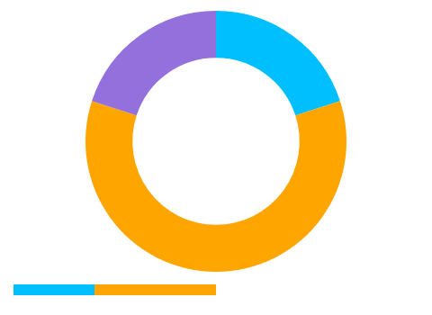

# Desktop dependency audit — 2026-10-12

Owner: VS-1994, [issue #776](https://github.com/ATAC-Helicopter/VaultSync/issues/776).
Release: 1.9.0; preparation branch `work/1.9-roadmap-realignment`, PR #736.
This is maintenance evidence, not installed-release or imaging qualification.

## Servicing and removal

| Package family | Before | After | Decision |
| --- | --- | --- | --- |
| Five Avalonia direct packages | 12.1.2 | 12.1.4 | Update together; both UI target frameworks compile. |
| Dapper | 2.1.86 | 2.1.89 | Patch update; SQL consumers remain active. |
| xunit.runner.visualstudio | 4.0.0 | 4.0.1 | Update runner; retain xUnit v2 discovery and regressions. |
| LiveChartsCore and two rendering adapters | 2.1.0-dev-798 | Removed | Two static storage summaries now use Avalonia drawing. |

Current versions were checked against NuGet and the primary package/release pages:
[Avalonia](https://www.nuget.org/packages/Avalonia/12.1.4),
[Dapper releases](https://github.com/DapperLib/Dapper/releases),
[xUnit runner](https://www.nuget.org/packages/xunit.runner.visualstudio/4.0.1).
The solution's complete direct/transitive outdated audit finds no remaining
outdated direct packages. The remaining newer transitive packages are NWayland
0.11.0 → 0.12.5 and Tmds.DBus.Protocol 0.94.1 → 0.95.1. They remain at Avalonia's
resolved versions until Linux Wayland/DBus runtime compatibility is qualified.

The UI assets graph contains 44 package identities before and 41 after. Three
runtime assemblies are removed: LiveChartsCore.dll (937,472 bytes),
LiveChartsCore.SkiaSharpView.dll (168,960 bytes), and
LiveChartsCore.SkiaSharpView.Avalonia.dll (445,440 bytes), totaling 1,551,872
bytes (about 1.48 MiB). These are uncompressed managed file sizes from the
previous graph's runtime assets, not installer size or a memory/latency benchmark.

## Why these replacements are bounded

`StorageChart` draws only a proportional ring and a percentage bar through
Avalonia's existing renderer. It uses immutable slice data, render invalidation
from styled properties, and no timer, animation engine, chart axes or native
library of its own. The weekly activity UI already uses Avalonia controls; its
unbound LiveCharts series/axis construction is removed.

Project colors, localized legend text, sorting, legend tooltips, top consumers,
empty states and retention of previously loaded data on transient refresh failure
remain. The donut stays noninteractive, as before. The bar keeps disk-free space
unfilled and clips overcommitted percentages. Invalid/non-finite slices are
ignored; scaling avoids overflow when summing very large byte values.

## Intentional retained dependencies

- All eleven SkiaSharp/HarfBuzzSharp managed/native ABI overrides remain aligned
  at 4.153.1 / 14.2.1.301. Avalonia itself imports WebAssembly assets transitively.
  Removing their direct pins brought back SkiaSharp 3.119.4 and HarfBuzzSharp
  8.3.1.3 without removing either package; that experiment was reverted.
- SQLitePCLRaw.bundle_e_sqlite3 3.0.5 and System.Drawing.Common 10.0.12 remain
  explicit security overrides. Sqlite, ProtectedData and the renderer support
  actual storage, Windows credential protection and Avalonia consumers.
- Dapper is used throughout the database services; replacing its query binding
  would spread custom mapping and compatibility responsibilities across them.
- Both Spectre packages have extensive CLI consumers. They remain paired at
  0.57.2 after the separately tracked API adaptation.
- ColorPicker, Fluent themes, Desktop and Wayland have active UI/startup uses.
- Windows notifications modernization belongs to VS-1928/#586. xUnit v3 belongs
  to VS-1929; neither planned migration is disguised as a patch update here.
- Existing workflow action pins are retained. Dependabot PRs #763/#765 remain
  subject to independent review and protected integration; this batch does not
  claim that those PRs were merged.

## Local verification

- Serialized warning-as-error Release solution build: zero warnings/errors.
- Core suite: 1,099 passed, one explicit Windows symlink-privilege skip; 1,100 total.
- Six new chart cases cover ordering/colors, proportions, free space,
  overcommit clipping, invalid/empty values and extreme values/full rings.
- Python suite: 149 passed, two explicit Windows symlink skips; 151 total.
  Native-family tests also require every desktop/transitive override in the UI.
- Family/import, public metadata, compact changelog and disk-plan checks pass.
  Four disk profiles remain candidates, none qualified.
- Complete NuGet direct/transitive vulnerability scan: no known vulnerable
  packages reported for all five solution projects using the configured feeds.
- Windows native Avalonia offscreen renders at 96 DPI, 480×350, check multiple
  projects, a single full ring and an empty ring. The same live control receives
  replacement `Segments` values between renders; no manual invalidation is used.

The preview is a focused native control harness, not a full Dashboard window.
It does not qualify installed Linux/macOS startup, every theme/DPI/RTL layout,
notifications, Wayland/DBus updates, release upgrade or disk recovery. Those
platform/release gates remain open. Project #7 stays In progress; Start is the
issue creation date and Target remains the 1.9.0 contract date, 2027-03-26.
