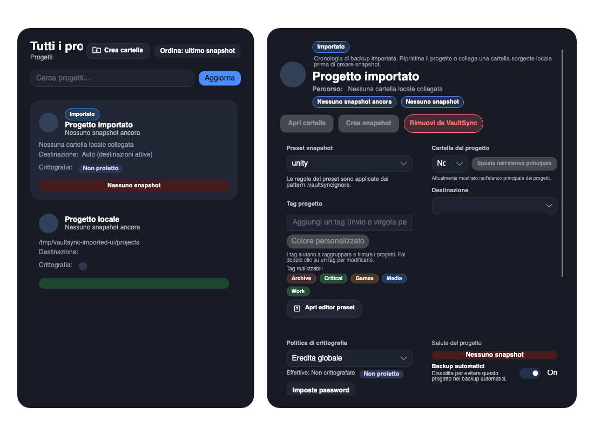

# Imported projects in Projects — 2026-10-13

Owner: VS-1995 / #784. Preparation: `work/1.9-roadmap-realignment`, PR #736
into `Dev`. Previous implementation head: `7d57257`.

Projects now includes registered entries with no source path and presents a
translated Imported badge in cards, compact rows and details. Details explain
whether source content exists locally. Missing imported sources cannot trigger
snapshot creation or the source-folder action. History remains usable for recovery.
Restored folder discovery matches by path and keeps the registered identity/name.

The additive local `projects.is_imported` column is independent of `needs_restore`
and portable metadata settings. Metadata and legacy backup creation mark new
projects imported. Origin persists through path changes and clearing restore state.
For older rows, only imported-only backup history plus an unavailable source can
recover the flag; any local backup or available folder prevents inference.
No missing drive or restore flag alone is treated as import provenance.

Mandatory local `bash scripts/validate_development.sh release` passed: 0 build
warnings/errors, 1,177 Core tests without skips and 154 Python tests. Seven new
presentation/repository cases cover rootless entries, restored path/name identity,
additive schema migration, historical inference/idempotence and disabled actions.
Existing metadata import coverage now asserts the import marker. All four new
keys are present in all 19 locales. Logs:
`/var/folders/98/rp_mspy95h175s5xn22b7gqc0000gn/T/vaultsync-validation.YE8B8u`.

A temporary native macOS harness initialized the actual UI app with an isolated
configuration/database and synthetic imported/local records. It attached the actual
ProjectsView, rendered it at 96 DPI and visually checked Italian import labels,
missing source explanation and disabled source actions. The initial unattached
view rendered blank and was not accepted as evidence; the attached render below
is the observed result. The temporary PNG save API emitted an obsolete-overload
warning in the external harness, separate from the warning-free repository build.

This is focused card/detail evidence, not full responsive-layout, compact visual,
installed desktop, Windows/Linux, live metadata import or exact 1.8.9 upgrade
qualification. Real user databases/backups were not used for the fixtures. No disk
recovery gate is closed. Project #7 remains In progress with Start 2026-10-13,
Target 2027-03-26; #784 stays open and #736 stays draft.
