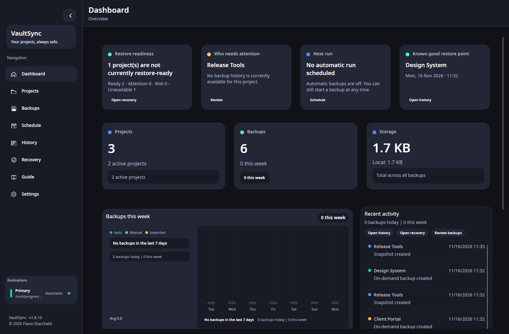

# VaultSync Wiki

Welcome to the VaultSync documentation.

VaultSync is an open-source backup and recovery application for Windows, macOS, and Linux. This wiki explains how to configure protection, inspect backup history, verify stored data, and recover files safely.

## Getting Started

- [Installation](Installation.md) — Download and install VaultSync on your platform.
- [Quick Start](Quick-Start.md) — Create and verify your first backup.
- [Guided Tour](Guided-Tour.md) — Explore the desktop application.
- [Recovery Lab](Recovery-Lab.md) — Practice a safe backup and restore with disposable files.
- [Configuration](Configuration.md) — Configure projects, backup destinations, and protection.
- [Settings Reference](Settings-Reference.md) — Understand individual settings and controls.

**New to VaultSync?** Start with the Quick Start, then complete the Recovery Lab using disposable data.

## Backups and Storage

- [Backups Overview](Backups.md)
- [Backup Pipeline](Backup-Pipeline.md)
- [Encryption](Encryption.md)
- [Destinations](Destinations.md)
- [Network Shares and NAS](Network-Shares.md)
- [Snapshots](Snapshots.md)
- [Metadata Synchronization](Metadata-Sync.md)
- [Tray Menu](Tray.md)

A snapshot, a stored backup, and a verified restore are different things. See the [Backup Pipeline](Backup-Pipeline.md) for an explanation of how the pieces fit together.

## Verification and Recovery

- [Recovery Guide](Recovery.md) — Run read-only drills and interpret recovery evidence.
- [Recovery Lab](Recovery-Lab.md) — Restore disposable test data to an independent destination.
- [Snapshots](Snapshots.md) — Inspect and compare recorded project states.

A completed backup does not guarantee that every file can be restored. A passing recovery drill validates the checks that ran, but important data should also receive periodic real test restores.

### Chronicle (1.8)

The Chronicle release family introduced and expanded workflows for understanding backup history and recovery readiness:

- History, Snapshot Explorer, and comparisons.
- Read-only recovery drills and bounded stored-data verification.
- Recovery readiness and the 3-2-1 protection advisor.
- Protected recovery points and retention safeguards.

## Installation and Updates

- [Installation Guide](Installation.md)
- [Updates and Release Channels](Updates.md)
- [Official Releases](https://github.com/ATAC-Helicopter/VaultSync/releases/latest)

Use official release assets and verify published checksums. Development branches and unpublished release plans are not substitutes for a qualified release.

## Community and Support

- [Community and Support Guide](../COMMUNITY.md)
- [Troubleshooting](Troubleshooting.md)
- [Frequently Asked Questions](FAQ.md)
- [Reporting Bugs](Reporting-Bugs.md)

Join the community through [Discord](https://discord.gg/sgP8UzeAQt), [r/VaultSync](https://www.reddit.com/r/VaultSync/), or [GitHub Discussions](https://github.com/ATAC-Helicopter/VaultSync/discussions).

Discord offers public discussion, optional private support tickets, ideas, and development participation. You do not need Discord to use VaultSync.

Reproducible software bugs belong on [GitHub Issues](https://github.com/ATAC-Helicopter/VaultSync/issues/new/choose). Suspected security vulnerabilities must follow the [private security reporting policy](../../SECURITY.md).

## Development and Roadmap

VaultSync continues to develop additional recovery capabilities, including planned offline system-disk recovery.

**Bootable system recovery is not a capability to assume is available in the latest stable release.** Platform and disk-profile support must be explicitly qualified and published.

- [Roadmap](../../ROADMAP.md)
- [Changelog](../../CHANGELOG.md)
- [Contributing](../../CONTRIBUTING.md)
- [Security Policy](../../SECURITY.md)
- [Documentation Hub](../../DOCUMENTATION.md)

---

[VaultSync Repository](https://github.com/ATAC-Helicopter/VaultSync) · [Download](https://github.com/ATAC-Helicopter/VaultSync/releases/latest) · [Website](https://fglabs.dev/vaultsync) · [Discord](https://discord.gg/sgP8UzeAQt) · [Reddit](https://www.reddit.com/r/VaultSync/)
