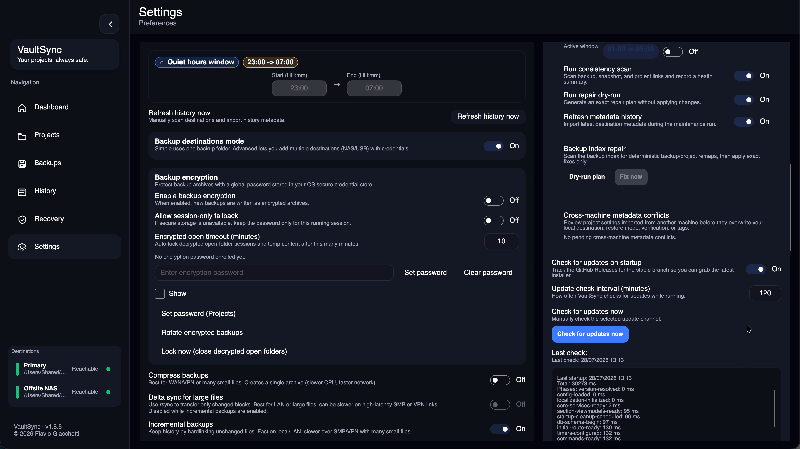

# Metadata Sync

VaultSync can export a portable metadata store to backup destinations and later import that metadata on another machine.

## Automatic imports while VaultSync is open

With metadata sync and auto-import enabled globally and for the destination,
VaultSync checks active destinations about every five minutes. The first timer
check is about one minute after startup. This check runs independently of the
optional daily maintenance window; existing per-destination throttles and failure
backoff still apply. You can turn auto-import off globally or per destination and
use manual refresh instead.

Automatic discovery uses destinations that are already accessible. It does not
create missing folders, run writability probes, ask for credentials or mount a
new share. Connect an unavailable share normally; a later pass can then import
its metadata. The pass skips unchanged sources and prevents overlapping imports.
Metadata previews and imports that prohibit source writes open a private
metadata copy, so SQLite cannot create auxiliary files on the destination. This
includes the manual preview/review/import flow. Required WAL/journal files must
copy successfully; source file sets, sizes and headers are checked around the
copy. A change or copy failure stops the operation instead of using a partial
copy or falling back to the source. Manual review still controls local deletion
changes independently of source-write permission. Passive resolution also
avoids starting an SMB keepalive writer.
Automatic destination import does not invoke backup retention or delete payloads.
Manual actions and separately enabled maintenance keep their own policies.

Project identities and portable project settings use the existing safe merge
rules below. Local source folders, credentials and machine-specific destination
configuration remain local. Full app configuration and custom preset catalogs
are not synchronized by this feature. Conflicts remain reviewable rather than
silently forcing every machine's local settings to match.

## Where it lives
- Destination metadata is stored under `.vaultsync/meta/` at the destination root.
- The SQLite store file is `vaultsync.meta.db`.

## What it carries
- Project identity: external id, name, preset, root path hint, timestamps
- Portable project settings:
  - avatar color
  - encryption policy (never the machine-local key reference)
  - preferred destination id
  - restore mode
  - verification policy
  - auto-backup enabled state
  - tags
- Snapshot summaries:
  - file count
  - total bytes
  - diff summary fields
  - top changed paths summary
- Backup history fields:
  - backup type
  - backup mode
  - relative backup path
  - destination alias
  - source machine name
  - keep/protected flag
  - non-secret encryption descriptor metadata
- Tombstones for deleted projects, snapshots, and backups

## What it does not carry
- Backup payload contents
- Plaintext passwords or secret material
- Full local app configuration
- Full destination definitions from another machine
- Encryption key references or credential identifiers

## Preferred destination behavior
- Imported `preferredDestinationId` values are normalized against your current configured destinations.
- If the imported value matches a configured destination id, alias, or path, VaultSync resolves it to the local canonical destination id.
- If the imported value does not match a local destination, VaultSync clears the unusable remote choice rather than retaining a foreign path or identifier.

## Conflict behavior
- Some project settings do not silently overwrite differing local values on existing projects.
- Avatar color, encryption policy, preferred destination, restore mode,
  verification policy, auto-backup state, and tags share one conflict record.
- Review these conflicts from `Settings > Advanced > Doctor`.
- Keep local and Accept imported create bounded durable resolution records, so
  an unchanged rejected revision does not reappear after restart.
- Automatic imports never apply project, snapshot, backup, or inferred deletion
  changes. Manual refresh lists each destructive category and requires review.

### Compatibility and mixed-version limits

The 1.8.6 metadata store is a portable inventory and recovery aid, not a fully
synchronized multi-writer configuration database. VaultSync 1.8.7 adds
schema-version-3 provenance, durable merge bases, field-level three-way merge,
and a repository-scoped writer lease.

- Legacy version-1 records remain readable but have no trustworthy record-level
  writer or common base, so they are handled conservatively.
- Version-2 project records carry a per-record writer and revision but lack the
  portable base and field provenance required for automatic three-way merging.
- Version-3 project fields share one review path, durable decisions, portable
  merge bases, and field-level provenance. Non-overlapping changes can merge;
  overlapping edits remain reviewable.
- The in-process metadata gate coordinates one running VaultSync process. The
  repository lease supplies the separate cross-machine writer boundary.

Since VaultSync 1.8.7, cooperating metadata writers are serialized by that
lease. A second client can still preview and import read-only, but it cannot
write tombstones or exports while the repository is busy. The lease can never
constrain a pre-1.8.7 client that does not understand the protocol. Do not let a
pre-1.8.7 client and a newer client write the same destination concurrently.

The current on-disk layouts, compatibility rules, and emergency inspection
boundary are documented in [Repository formats](../REPOSITORY_FORMATS.md).
The writer and merge threat model is in
[Cross-machine safety](../CROSS_MACHINE_SAFETY.md).

## Missing backup paths
- Import only materializes backups whose relative path still exists at the destination.
- If metadata references a backup path that no longer exists, VaultSync can record a tombstone instead of importing broken history.

## Related docs
- [Help](../HELP.md)
- [Documentation hub](../../DOCUMENTATION.md)
- [Backups overview](Backups.md)
- [Destinations](Destinations.md)
- [Troubleshooting](Troubleshooting.md)
