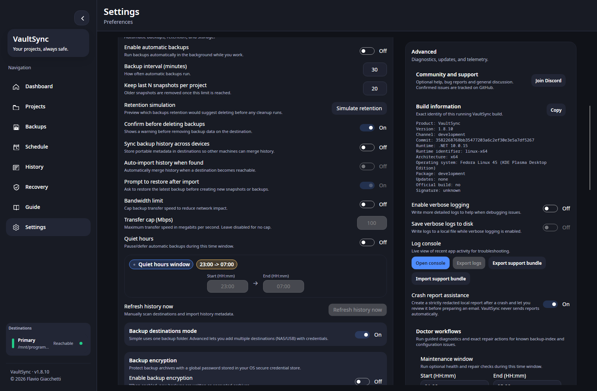

# Updates

VaultSync provides different update flows depending on the platform, installation method, and release channel.

Always use the [official GitHub Releases page](https://github.com/ATAC-Helicopter/VaultSync/releases/latest) to identify the latest published stable version.

## Distribution models

### Direct downloads

Direct builds for Windows, macOS, and Linux use GitHub release metadata to discover available updates.

Depending on platform, version, and published assets, VaultSync may offer:

- A compatible patch update.
- A full installer or package.
- A manual download when an automatic update is unavailable.

### Microsoft Store

Microsoft Store builds use Store-managed delivery rather than the GitHub patch or installer flow.

Use the Microsoft Store to manage updates for this distribution.

Do not mix the Store and Direct installation channels in place.

## Release channels

- **Stable:** published releases recommended for regular use.
- **Beta:** explicitly published test releases for early feedback.

Switch supported channels through **Settings > Advanced**.

A development branch, planned milestone, or unpublished release is not an available update.

## Checking for updates

1. Open **Settings**.
2. Navigate to **Advanced**.
3. Select **Check for updates now**.
4. Review the displayed release channel and update status.

Microsoft Store builds direct users to the Store rather than offering the GitHub installer workflow.

## Patch update eligibility

Patch updates are offered only when the published patch manifest explicitly permits the installed version.

VaultSync uses numeric version comparison. For example, `1.8.10` is newer than `1.8.9`, but that comparison alone does not establish patch compatibility or release availability.

The patch manifest must list the installed version as an allowed base version.

### Exact version allowlists

A single target release can support more than one exact predecessor.

These are strict allowlists, not version ranges.

A predecessor is eligible only when its published managed-file inventory satisfies the release pipeline's compatibility requirements for the target payload.

Eligibility is evaluated independently for each supported platform.

### When a patch is unavailable

Use the appropriate full installer or package when:

- Your installed version is not in the manifest allowlist.
- You are upgrading across an unsupported version gap.
- Patch preflight blocks the operation.
- Required or trusted patch assets are unavailable.
- The current platform or installation method does not support that patch.

A newer release being discoverable does not guarantee a compatible patch.

## Patch assets and verification

Published patch assets use platform-specific manifest and ZIP files.

The general naming pattern is:

- `vaultsync-patch-<platform>.json`
- `vaultsync-patch-<platform>.zip`

Where applicable, macOS checks architecture-specific patch assets before generic ones, including Apple Silicon and Intel variants.

Linux similarly checks supported x64 and ARM64 variants.

Direct updates verify required trusted release metadata, including payload size and SHA-256 digests. Missing or mismatched trusted values block the affected update.

Updater preflight diagnostics help explain why patching is allowed or blocked.

## Platform-specific behavior

### Windows

Direct releases use an Inno Setup `.exe` installer.

Microsoft Store packages follow the Store update mechanism.

### macOS

Direct releases use architecture-specific `.dmg` packages containing the canonical `VaultSync.app` and an Applications shortcut.

The 1.8.7 update path includes a one-time migration from the exact 1.8.6 predecessor to the canonical `/Applications/VaultSync.app` location.

Older or unqualified installations should use the corresponding full DMG.

Later qualified patches update the canonical application bundle and verify its metadata.

### Linux

Published assets may include `.AppImage`, `.deb`, and `.tar.gz`, depending on architecture.

For Debian-package updates, VaultSync waits for the administrator-authentication and package-installation result. Cancelling authentication leaves the existing app running.

After successful installation, the replacement application starts only after the old process exits.

AppImage updates use a similar deferred handoff to avoid conflict with the running instance.

## Skipping a version

Use **Skip version** in the update banner if you do not want to install that version.

You can clear the skipped-version setting later to allow the banner to appear again.

## Troubleshooting

### Update banner is stuck

1. Close the banner.
2. Run **Check for updates now**.
3. Review the channel and updater diagnostics.
4. If patch preflight is blocked, use the appropriate installer fallback.

### An update is available but no patch is offered

This can be expected when the installed version is not an explicitly allowed patch predecessor.

Check the official release assets and full-installer path.

### An update fails verification

Do not bypass an integrity failure.

Recheck the official published assets and SHA-256 information. Report reproducible problems using the [GitHub issue forms](https://github.com/ATAC-Helicopter/VaultSync/issues/new/choose).

## Update safety

- Download only from official VaultSync release sources.
- Compare published SHA-256 digests before bypassing operating-system security warnings.
- Do not use unverified mirrors or third-party repackaged installers.
- Do not treat unpublished development artifacts as production releases.
- Preserve independent backups and periodically test restoration.

For additional details, see the [Installation Guide](Installation.md), [Updater Documentation](../UPDATER.md), and [Troubleshooting](Troubleshooting.md).
